<p align="center">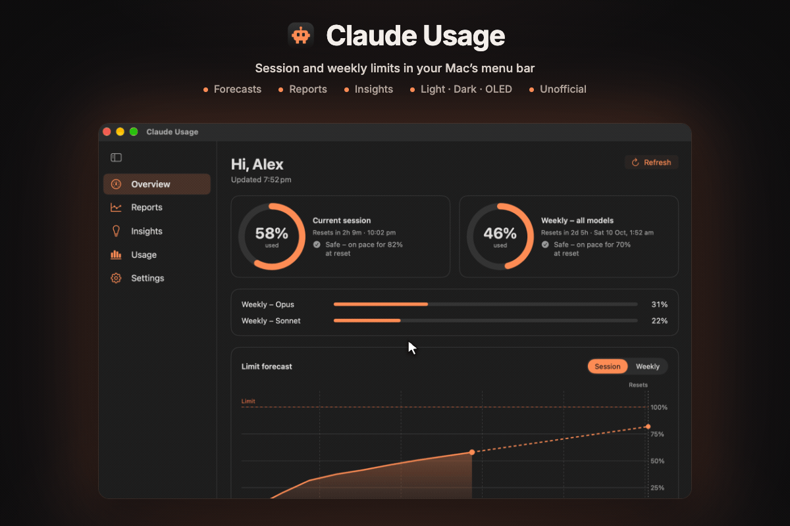</p>

<h1 align="center">Claude Usage – Claude Code usage tracker for the macOS menu bar</h1>

<div align="center">

[](https://github.com/Ol775/Claude-Usage/releases/latest)
[](LICENSE)


</div>

<p align="center"><a href="#features">Features</a> · <a href="#tour">Tour</a> · <a href="#install">Install</a> · <a href="#faq">FAQ</a> · <a href="#roadmap">Roadmap</a> · <a href="#security">Security</a></p>

**Claude Usage** is a free, open-source Mac app that shows your **Claude Code session and weekly usage limits** in the menu bar, with reset times, forecasts of when you'll hit the limit, and charts of your token usage. It's a native Swift and SwiftUI app for macOS 13 and later (the download runs natively on both Apple silicon and Intel Macs), with Light, Dark and OLED black themes. Current version: <!--v-->v0.16.12 beta<!--/v-->.

Keep an eye on how much of your Claude plan (Pro or Max) you've used, avoid hitting the limit mid-task, and see what your usage would cost at API prices. The source is in [`ClaudeUsage/`](ClaudeUsage).

## Features

### Limits and forecasts

- Real **session** and **weekly** limits with reset times (same numbers as Claude Code's `/usage`)
- **Forecasts** of when you'll hit a limit at your current pace – weekly forecasts also learn from your saved history – plus early-warning notifications

### Reports and history

- **Reports**: day / week / month graphs of tokens and limit utilisation, with peaks per session and per week
- **Insights**: heavy and light days, sessions per day/week, messages, tool calls, API-equivalent cost, per-model and per-project usage, and a yearly heatmap
- Activity is saved on your Mac, so history outlives Claude Code's own log clean-up

### Appearance and menu bar

- Light / Dark / **OLED black** / Follow system, six colour themes plus **any custom colour** (Claude orange by default)
- **Make it yours**: five fonts including the built-in **OpenDyslexic**, four text sizes, card corners, your own greeting name, a **menu bar icon in any colour**, and your profile picture in the sidebar
- Menu bar display options, configurable alert thresholds, **quiet hours** and **Snooze 1 Hour** / **Open Dashboard** buttons on alerts
- Optional local profile photo

### ChatGPT, experimental

- Optional, **experimental** **ChatGPT (Codex) usage** for paid plans: connect through OpenAI's Codex CLI sign-in to see your Codex limits next to Claude's – on the Overview, in the menu bar menu, as a menu bar item (`G 34%`) and on the forecast and report charts

### Data and other computers

- CSV export, copy-summary, **settings export/import** to move to another Mac, a choice of how long history is kept, and **other computers**: add a synced Claude Code log folder (e.g. from Windows) to count its tokens too (the [Windows helper](windows/README.md) copies a Windows PC's logs into a synced folder, on a schedule)

### Accounts, languages and accessibility

- Sign in/out through Claude's official login (via Claude Code)
- Settings and the menu are available in **English, German, French and Spanish**
- **Accessible**: every control is named for VoiceOver (including the menu bar menu), and the app respects Reduce Motion and Increase Contrast. Custom accent colours are kept readable (WCAG AA contrast)
- **Help & Legal** in Settings: terms, privacy notes and a Report a Bug button

### Updates

- **Updates**: notifies when a newer version is on GitHub, and **Update Now** downloads the signed release with a progress bar, verifies it, swaps it in (keeping a backup) and relaunches – no Terminal needed. `./update.sh` does the same from the command line. Turn on **Get beta versions** in Settings → About to try test releases early

> [!NOTE]
> Limits come from Claude Code's login in your own keychain; nothing is stored in this repo.  
> API-equivalent costs use Anthropic's published API prices and are only a guide – a Claude plan isn't billed that way.  
> Unofficial – not affiliated with Anthropic.

## Tour

### Limits, forecasts and history

The Overview shows your **session** and **weekly** limits with reset times and a forecast of when you'll hit them. **Reports**, **Insights** and **Usage** turn your saved activity into charts of tokens, limit utilisation, API-equivalent cost and your busiest days, per model and per project.

### Make it yours

<a href="docs/feature-themes.gif">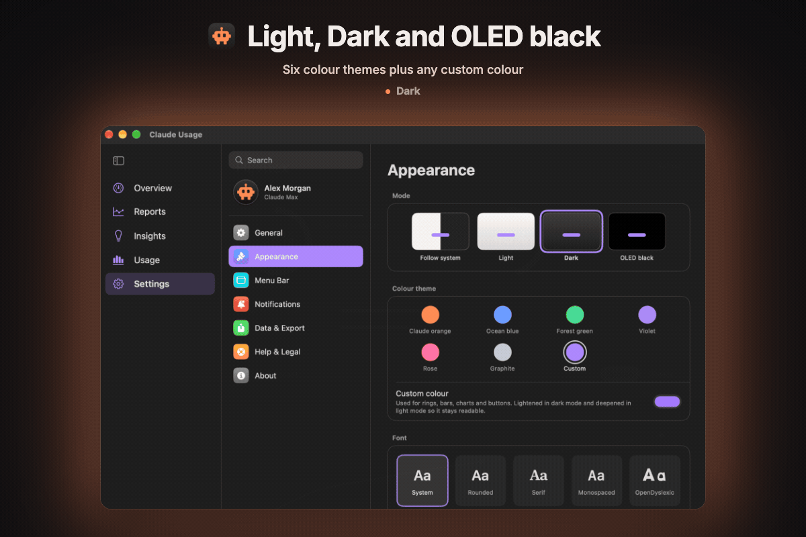</a>

Light, Dark, **OLED black** or follow the system, six colour themes plus any custom colour, five fonts including OpenDyslexic, and a profile picture in the sidebar.

### A menu bar item you design

<a href="docs/feature-menubar.gif">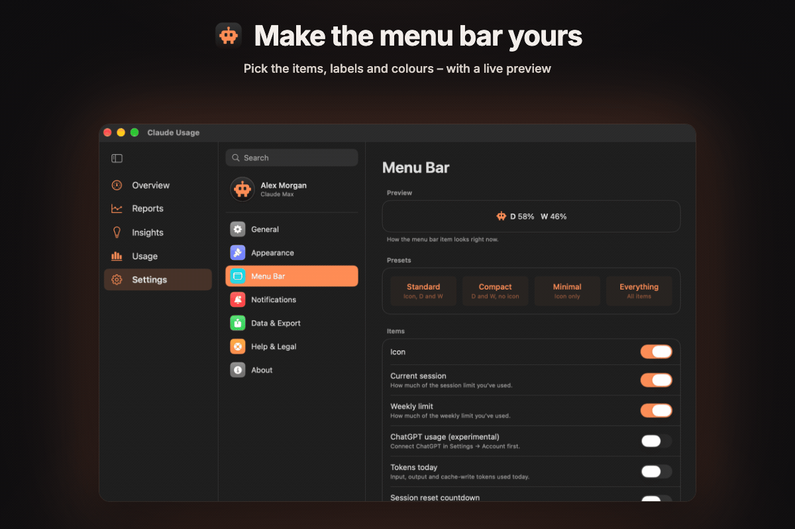</a>

Pick the items, labels and colours, with a live preview of what the menu bar will show, or start from a preset.

### ChatGPT next to Claude *(experimental)*

<a href="docs/feature-chatgpt.gif">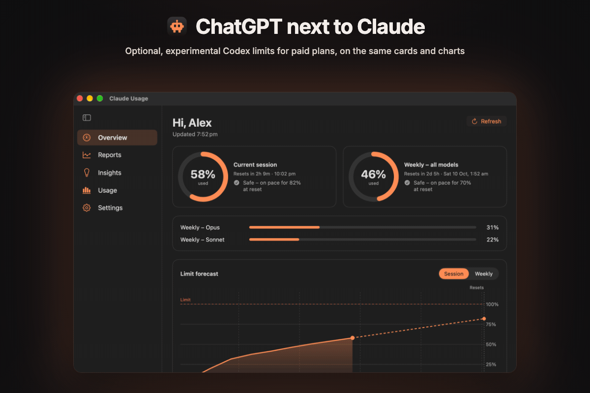</a>

Optional Codex limits for paid ChatGPT plans, on the same cards and charts. Nothing is read until you connect it.

<details>
<summary><b>More screenshots</b></summary>

<br>

<table>
<tr>
<td width="50%">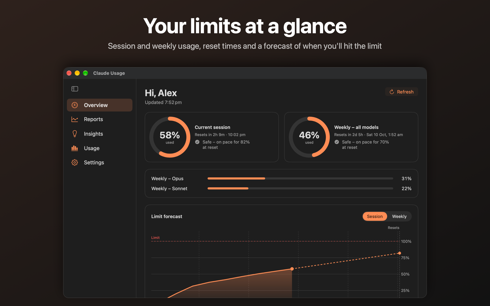</td>
<td width="50%">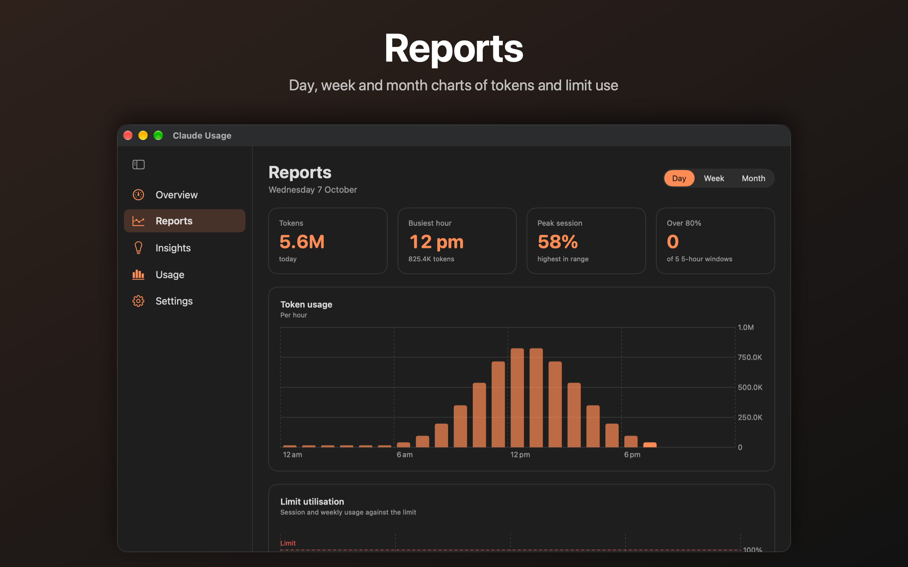</td>
</tr>
<tr>
<td width="50%">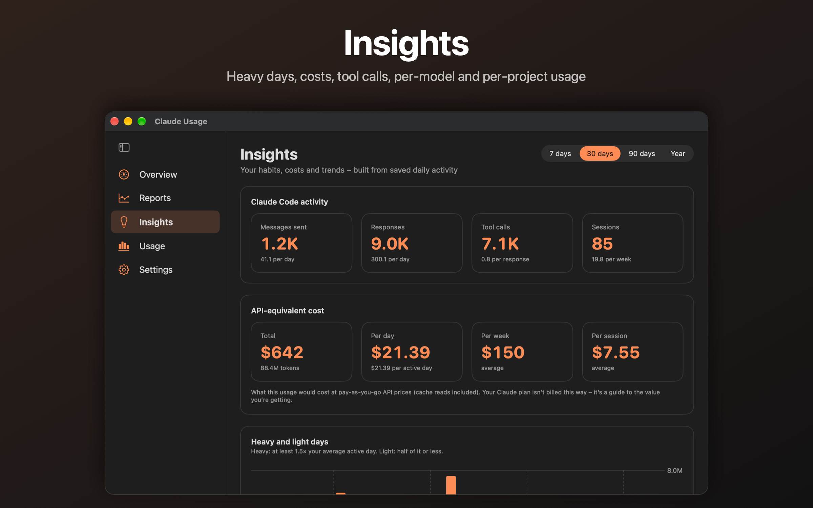</td>
<td width="50%">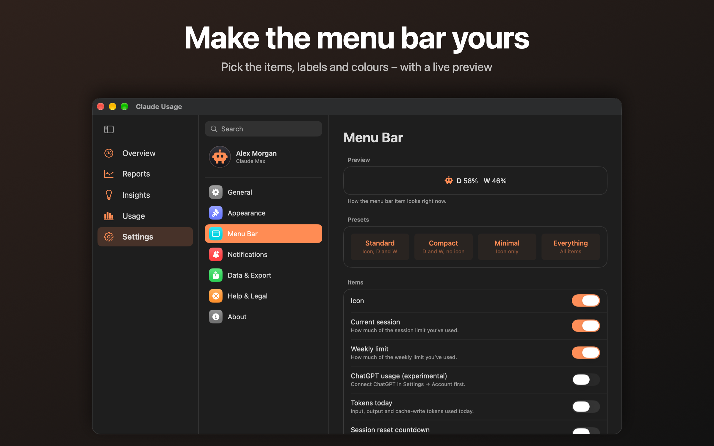</td>
</tr>
<tr>
<td width="50%">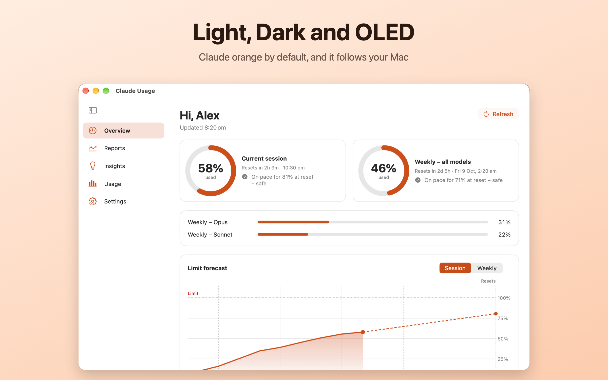</td>
<td width="50%">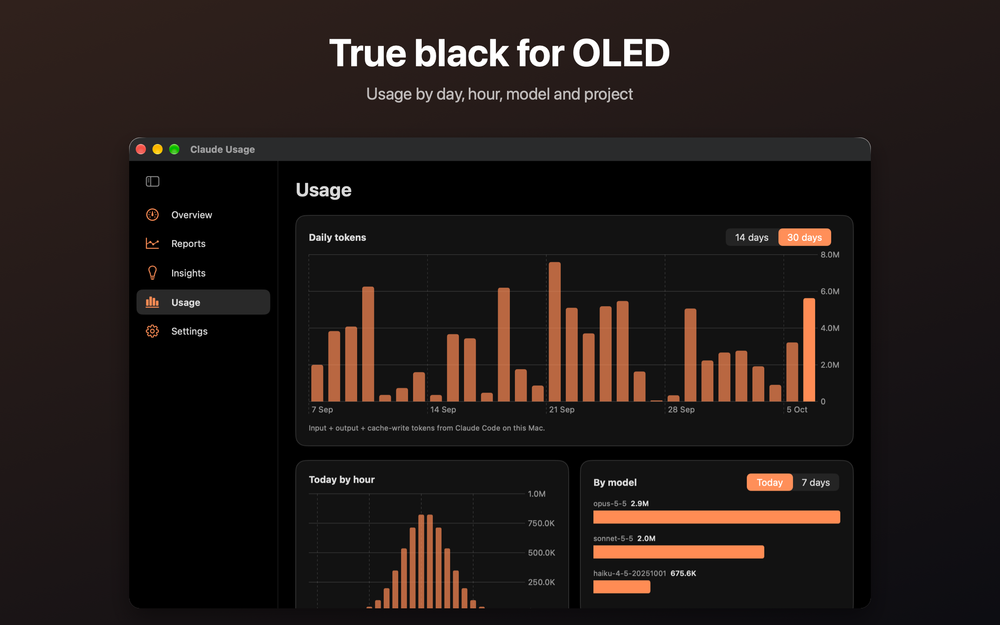</td>
</tr>
<tr>
<td colspan="2">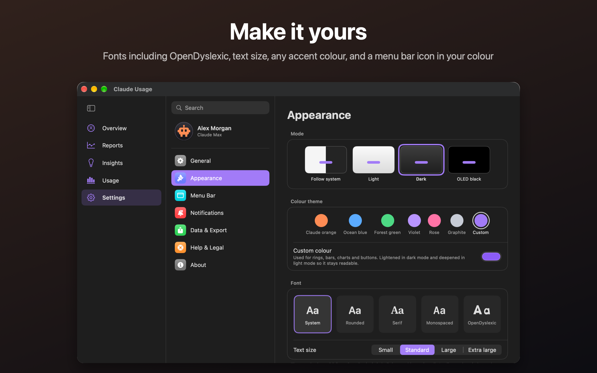</td>
</tr>
<tr>
<td colspan="2">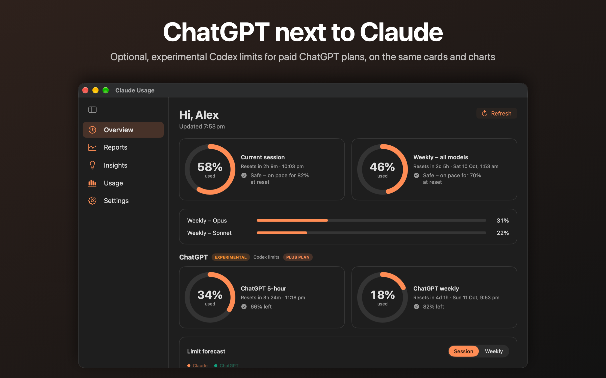</td>
</tr>
</table>

</details>

## Install

Requires macOS 13 or later and [Claude Code](https://claude.com/claude-code) signed in on the same Mac (Claude Usage reads its login and logs).

**Option 1 – DMG.** Download `Claude-Usage-<version>.dmg` from the [latest release](https://github.com/Ol775/Claude-Usage/releases/latest), open it and drag *Claude Usage* to *Applications*.

**Option 2 – Terminal.** One line; it downloads the latest DMG, installs to `/Applications` and opens the app:

```sh
curl -fsSL https://raw.githubusercontent.com/Ol775/Claude-Usage/main/install.sh | zsh
```

**Option 3 – Homebrew.** Installs the same DMG and clears the macOS quarantine flag, so there's no first-launch prompt:

```sh
brew install --cask Ol775/tap/claude-usage
```

<details>
<summary><b>Option 4 – Build from source</b> (needs the Xcode command line tools)</summary>


```sh
git clone https://github.com/Ol775/Claude-Usage.git
cd Claude-Usage/ClaudeUsage && ./build.sh      # then copy "Claude Usage.app" to /Applications
./make-dmg.sh                                  # optional: builds dist/Claude-Usage-<version>.dmg
```

</details>

### First launch

> [!TIP]
> The app is ad-hoc signed (there's no paid Apple developer certificate), so macOS may refuse to open it the first time. Right-click the app, choose **Open**, then **Open** again. Or run:

```sh
xattr -dr com.apple.quarantine "/Applications/Claude Usage.app"
```

The terminal and Homebrew installs do this for you. Every release also ships a `.sha256` file if you want to check the download (`shasum -a 256 Claude-Usage-<version>.dmg`); the terminal install checks it automatically.

### Updating

The app checks GitHub releases for new versions and downloads the disk image in the background with a progress bar, verifies its signature and checksum, then asks you to restart. If a copy can't replace itself (for example it's running from the disk image), it downloads the verified installer to your Downloads folder instead. No developer tools needed. You can also run `./update.sh` from a clone, or just re-run the install command above.

## Reporting bugs

Use **Settings → Help & Legal → Report a Bug** in the app (it fills in your version and macOS), or [open an issue](https://github.com/Ol775/Claude-Usage/issues/new/choose) here. See [CONTRIBUTING.md](CONTRIBUTING.md) if you'd like to help. Please don't paste tokens or private logs.

## Roadmap

Claude Usage is in **beta**. See the [roadmap to 1.0](ROADMAP.md) for what's planned.

## Support the project

Claude Usage is free and open source. If it's useful, you can [buy me a coffee](https://buymeacoffee.com/ol775) – entirely optional, and always appreciated.

<p align="center"><a href="https://buymeacoffee.com/ol775"></a></p>

## FAQ

<details>
<summary><b>How do I check my Claude Code usage limits on a Mac?</b></summary>

Install Claude Usage and it shows your current session and weekly limits in the menu bar (for example `D 58%  W 46%`), using the same numbers as Claude Code's `/usage` command.

</details>

<details>
<summary><b>Does it work with Claude Pro and Max?</b></summary>

Yes. It reads the limits for whichever Claude account Claude Code is signed in to.

</details>

<details>
<summary><b>When will I hit my Claude usage limit?</b></summary>

The app forecasts it from your recent pace and warns you with a notification before you get there. Forecasts are estimates, not guarantees.

</details>

<details>
<summary><b>Can it show my ChatGPT usage too?</b></summary>

Yes, as an **experimental** option, for **paid** ChatGPT plans (Plus, Pro, Business or Enterprise). Install OpenAI's [Codex CLI](https://github.com/openai/codex) (`brew install codex`), then choose **Settings → Account → ChatGPT → Connect**. It shows your Codex usage limits (a 5-hour and a weekly window) next to Claude's. Free plans aren't supported. Nothing is read until you connect, and the app only reads Codex's saved sign-in to ask ChatGPT for your limits – it never changes, copies or stores it.

</details>

<details>
<summary><b>Is it official, and is it safe?</b></summary>

It's an unofficial, open-source app, not affiliated with Anthropic. It runs on your Mac, has no analytics, and only talks to Anthropic (for your limits), ChatGPT (only if you connect it) and GitHub (for updates). The code is all here to read.

</details>

<details>
<summary><b>How do I update it?</b></summary>

It checks for new versions, downloads them in the background and asks you to restart. See [Updating](#updating).

</details>

## Security

The app reads only your own Claude Code login and logs. Details, and how to report a problem privately, are in [SECURITY.md](SECURITY.md).

### How updates are verified

Each release is signed with a key that is kept offline, never on GitHub. Before installing an update, the app checks that:

1. it was downloaded from this repo's GitHub releases over HTTPS;
2. its signature is valid for exactly that version number, so an old release can't pose as a new one;
3. its SHA-256 checksum matches;
4. the app inside has the right bundle id, version and an intact code signature.

If any check fails, the download is thrown away. So even someone who took over this GitHub account couldn't push a trusted update without the offline key. More in [SECURITY.md](SECURITY.md#how-updates-are-trusted).

## Privacy and legal

Everything stays on your Mac. The app only talks to Anthropic (for your usage limits), ChatGPT (for your ChatGPT limits, only if you connect it) and GitHub (for updates); there are no analytics. Limits come from Claude Code's login in your own keychain, and nothing is stored in this repo. API-equivalent costs use Anthropic's published API prices and are only a guide – a Claude plan isn't billed that way. The full terms are in the app under Settings → Help & Legal, and the privacy statement is in [PRIVACY.md](PRIVACY.md).

> [!NOTE]
> **Unofficial – not affiliated with or endorsed by Anthropic.** "Claude" and "Anthropic" are trademarks of Anthropic, PBC; "ChatGPT", "Codex" and "OpenAI" are trademarks of OpenAI. Provided as is, with no warranty. The code is released under the [MIT licence](LICENSE).
