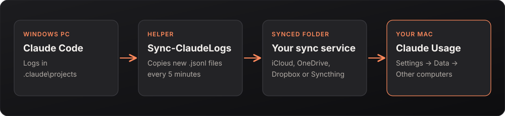

<p><a href="../README.md">&nbsp;Claude Usage</a></p>

# Windows helper: count Claude Code usage from a Windows PC

Claude Usage reads Claude Code's logs on the Mac it runs on. Claude Code on Windows keeps its logs on that PC, so its tokens and costs don't show up. `Sync-ClaudeLogs.ps1` copies those logs into a folder that syncs to your Mac, and the app reads them from there.

Your limit percentages (session and weekly) already include Windows usage, because they come from your account. This only adds the token, cost and activity charts.

<p align="center"></p>

## Set up

1. **Pick a synced folder** that appears on both computers: iCloud Drive for Windows, OneDrive, Dropbox, Syncthing or a shared network folder. For example `C:\Users\you\iCloudDrive\ClaudeLogs`. It can be a new folder; the script creates it.
2. **On the Windows PC**, download [`Sync-ClaudeLogs.ps1`](Sync-ClaudeLogs.ps1) and keep it somewhere permanent (for example `C:\Tools`). Open PowerShell in that folder and run:

   ```powershell
   powershell -ExecutionPolicy Bypass -File .\Sync-ClaudeLogs.ps1
   ```

   It asks for the folder from step 1, then whether to keep copying every 5 minutes in the background (answer `y`). The `-ExecutionPolicy Bypass` part is only needed if Windows blocks downloaded scripts.
3. **On the Mac**, open Claude Usage → Settings → Data → **Other computers** → **Add…** and choose the same synced folder as it appears on the Mac.

The Mac app picks the folder up at its next refresh (within a minute or so). Windows tokens are then included in Overview, Reports, Insights and Usage.

## Options

```powershell
.\Sync-ClaudeLogs.ps1 -Destination "C:\Users\you\iCloudDrive\ClaudeLogs"            # copy once, no questions
.\Sync-ClaudeLogs.ps1 -Destination "C:\Users\you\iCloudDrive\ClaudeLogs" -Install   # copy now, then every 5 minutes
.\Sync-ClaudeLogs.ps1 -Destination "C:\Users\you\iCloudDrive\ClaudeLogs" -Install -IntervalMinutes 30   # ... or every 30
.\Sync-ClaudeLogs.ps1 -Uninstall                                                    # remove the scheduled copy
.\Sync-ClaudeLogs.ps1 -Source "D:\somewhere\.claude\projects" ...                   # logs live somewhere unusual
```

`-Install` creates a scheduled task called **Claude Usage log sync** (visible in Task Scheduler). It runs as you, needs no administrator rights, and runs only while you're signed in. Keep the script where it was when you ran `-Install`, because the task runs it from there.

## What it does and doesn't do

- Copies only `*.jsonl` log files modified in the last year, and only files that are new or changed.
- Never deletes or changes anything in Claude Code's own folder (`%USERPROFILE%\.claude\projects`) or in the destination. Removing the helper leaves already-copied logs where they are.
- Has no network code of its own. Moving the files to your Mac is entirely up to the sync service you choose.

## Privacy

The logs contain your Claude Code conversations (prompts, replies, file contents Claude read). Whatever syncs the destination folder uploads them, so choose a service you trust, or a folder shared only on your own network. Claude Usage itself only reads the folder and never sends anything off your Mac. See [PRIVACY.md](../PRIVACY.md).

## Troubleshooting

- **Nothing shows up on the Mac:** check that the synced folder on the Mac contains `.jsonl` files in subfolders, and that it's the folder you added under Other computers. Wait for the sync service to finish.
- **"Claude Code logs not found":** Claude Code hasn't run on this PC yet, or its logs are elsewhere; use `-Source`.
- **Counted twice?** It shouldn't be: the app counts each message once, even if a folder or file is reachable twice.
- **Remove it all:** run `-Uninstall`, then remove the folder in Settings → Data → Other computers.
